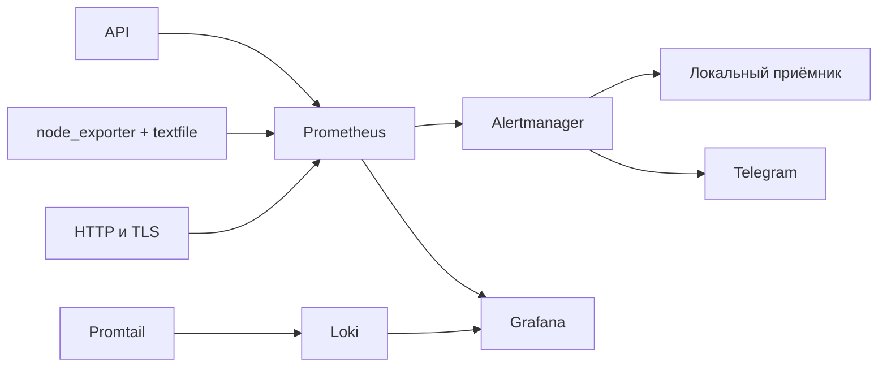

# monitoring-stack

[](https://github.com/nikit0id/monitoring-stack/actions/workflows/ci.yml)

Стек наблюдает за приложением [portfolio-api](https://github.com/nikit0id/portfolio-api), хостом и возрастом последнего бэкапа. Grafana читает дашборд и источники данных из файлов репозитория.



## Запуск за три команды

Сначала запустите portfolio-api по его README. По умолчанию стек подключается к сети portfolio-api_default этого Compose-проекта. Для боевого compose-app-cicd задайте API_NETWORK по имени его сети. Нужны Linux, Docker Compose, Python 3 и OpenSSL.

```bash
git clone https://github.com/nikit0id/monitoring-stack && cd monitoring-stack
scripts/init-env
scripts/up
```

Откройте http://localhost:3000 и дашборд «Portfolio API и хост». Пользователь admin, пароль находится в .env. Prometheus доступен на http://localhost:9090.

## Что внутри

- Правила проверяют недоступность node_exporter, диск выше 85%, высокую загрузку CPU, HTTP, сертификат со сроком меньше 14 дней и бэкап старше 36 часов. SITE_HTTPS_URL включает отдельную проверку реального HTTPS-адреса. Prometheus читает /metrics напрямую из сети API.
- Укажите BACKUP_METRICS_DIR с файлом pg_backup.prom из [pg-backup-toolkit](https://github.com/nikit0id/pg-backup-toolkit). node_exporter читает этот каталог через textfile collector.
- По умолчанию Alertmanager отправляет события локальному приёмнику. Заполните TELEGRAM_CHAT_ID и TELEGRAM_BOT_TOKEN в .env, затем выполните scripts/up и docker compose restart alertmanager. Для проверки воспользуйтесь scripts/verify, скрипт остановит и вернёт node_exporter на этом стенде.
- Promtail отправляет верхнеуровневые /var/log/*.log в Loki. В Grafana Explore выберите Loki и запрос `{job="hostlogs"}`. Promtail включён по заданию. Его срок поддержки завершён, при переносе на рабочий сервер потребуется миграция на Grafana Alloy.

## Что я узнал

- up показывает доступность точки сбора, а probe_success — результат HTTP-запроса клиента. Эти сигналы могут различаться.
- Значение for удерживает краткий сбой от немедленного оповещения. В тесте ожидаем событие именно от Alertmanager.
- Метрика последнего успешного бэкапа хранит Unix-время. Возраст можно вычислить в PromQL даже после перезапуска процесса резервирования.

## Что бы сделал дальше

- Перенести конфигурацию чтения журналов на Grafana Alloy.
- Проверить реальные сроки доставки Telegram в выбранный чат при сетевом сбое.
